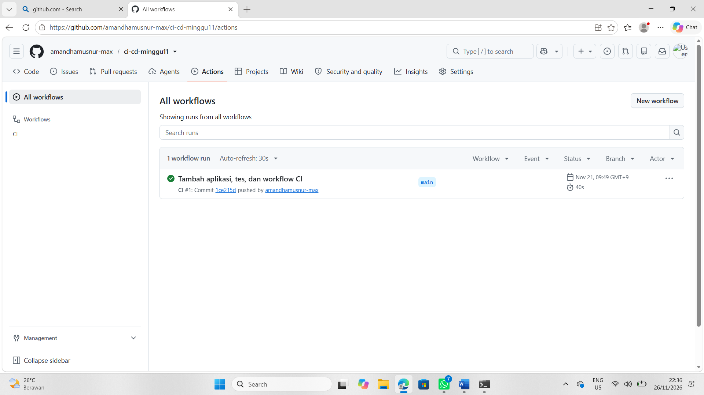
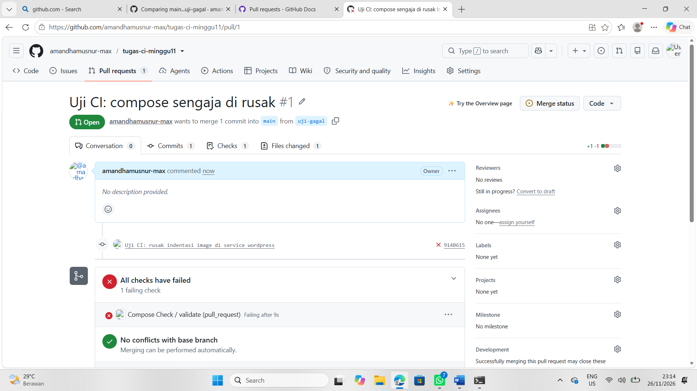
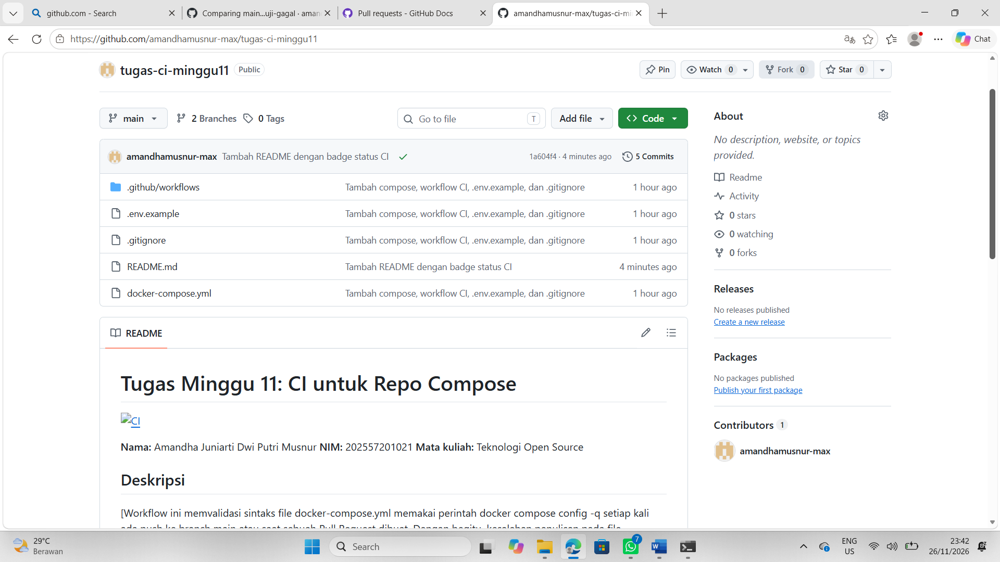

# Tugas Minggu 11: CI untuk Repo Compose

**Nama:** Amandha Juniarti Dwi Putri Musnur
**NIM:** 202557201021
**Mata kuliah:** Teknologi Open Source

## Deskripsi
[Workflow ini memvalidasi sintaks file docker-compose.yml memakai perintah docker compose config -q setiap kali ada push ke branch main atau saat sebuah Pull Request dibuat. Dengan begitu, kesalahan penulisan pada file Compose bisa diketahui sebelum perubahan digabungkan ke main.]

## Isi repositori
- .github/workflows/compose-check.yml : workflow CI
- docker-compose.yml : stack WordPress + MySQL (tugas minggu 10)
- .env.example : contoh variabel lingkungan tanpa rahasia asli
- .gitignore : mengabaikan .env

## Cara kerja workflow
[Workflow bernama Compose Check dipicu oleh dua kejadian, yaitu push ke branch main dan pull_request. Di dalamnya ada satu job bernama validate yang berjalan di runner ubuntu-latest milik GitHub. Job ini punya tiga step. Pertama, actions/checkout mengambil isi repositori ke runner. Kedua, perintah cp .env.example .env membuat file .env dari contoh, karena .env asli tidak ada di repositori dan variabelnya dibutuhkan oleh docker-compose.yml. Ketiga, docker compose config -q memeriksa sintaks file Compose tanpa menjalankan container. Jika semua step berhasil, job berwarna hijau, dan jika ada kesalahan, job berwarna merah.]

## Bukti
1. Run hijau di tab Actions
   
2. Pull Request dengan check gagal (merah)
   
3. Badge status di README
   

Tautan Pull Request (sudah hijau dan di-merge): https://github.com/amandhamusnur-max/tugas-minggu11/pull/1

## Kendala dan cara mengatasinya
[Pesan error dari kerusakan YAML dikira tidak muncul Pesan tersebut dicatat dan dicocokkan dengan log pada step Validasi file compose di GitHub Actions]

## Refleksi singkat
[Lewat tugas ini saya belajar bahwa CI bekerja seperti pemeriksa otomatis yang menjaga branch main tetap aman. Saat indentasi docker-compose.yml sengaja dirusak, Pull Request langsung berwarna merah dan menunjukkan baris yang salah, lalu berubah hijau setelah diperbaiki. Tanpa CI, kesalahan seperti itu baru ketahuan ketika file dijalankan. Saya juga belajar bahwa repositori publik harus bersih dari kredensial: password dari tugas minggu 10 sempat ikut ter-push, sehingga saya harus menimpa riwayat commit dan memindahkan password ke file .env yang diabaikan oleh .gitignore. Ke depan, saya akan memakai CI dan membiasakan memeriksa isi file sebelum commit pertama.]
